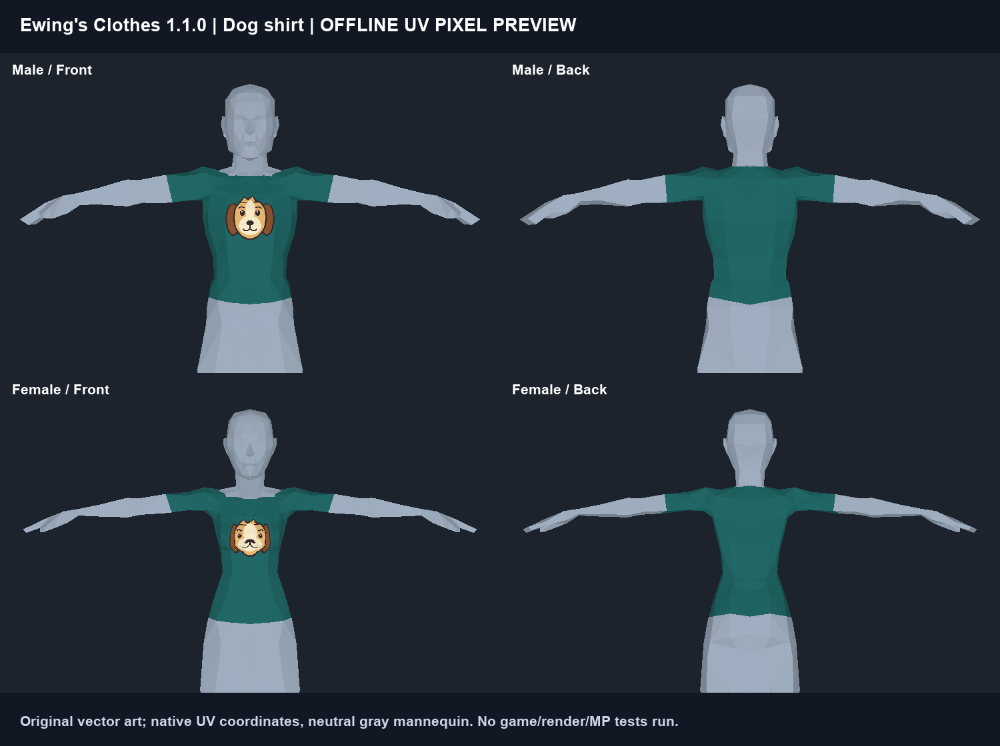
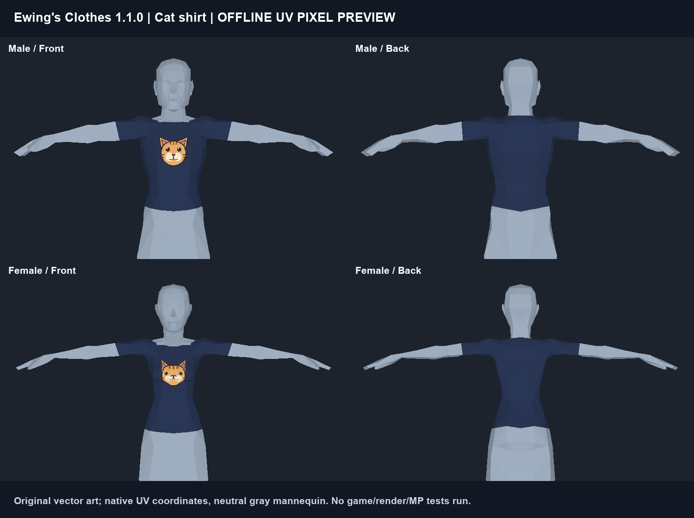

# Ewing's Clothes 1.1.0 — staged animal shirt update

Three native clothing items for inspected Project Zomboid **42.21**, Steam build **25485521**. Stable mod ID: **`EwingsClothes`**. The release ZIPs preserve the validated build exactly. Actual gameplay and multiplayer testing remain pending.

| Item ID | Design | Availability |
| --- | --- | --- |
| `EwingsClothes.OneJobTShirt` | Original purple shirt, yellow **One Job** | Rare clothing loot / debug |
| `EwingsClothes.DogTShirt` | Teal shirt, original friendly dog portrait | Rare clothing loot / dog-photo recipe / debug |
| `EwingsClothes.CatTShirt` | Navy shirt, original orange tabby portrait | Rare clothing loot / cat-photo recipe / debug |

The One Job item definition, XML, texture, icon, original artwork and earlier preview files are byte-for-byte preserved. Shared name/GUID registries gain only the new entries, while mod metadata advances to 1.1.0. Each design uses the existing native body-atlas structure, fixed colors and plain back. No slogans are added to animal shirts. No native photo pixels, models or game assets are bundled.

## Craft the fixed animal designs

The one-step Tailoring recipes need an unworn plain `Base.Tshirt_DefaultTEXTURE` or `Base.Tshirt_WhiteTINT`, a matching **`Base.Photo`** subject, a native paintbrush, and one native use from each of four paint colors. **The photo and brush are retained.** The photo is a reusable drawing reference; output artwork is fixed.

- Dog: `Base.PaintTurquoise`, `Base.PaintBrown`, `Base.PaintWhite`, `Base.PaintBlack`.
- Cat: `Base.PaintBlue`, `Base.PaintOrange`, `Base.PaintWhite`, `Base.PaintBlack`.
- Brush: `Base.Paintbrush` or `Base.PaintbrushCrafted`.
- Dog/cat/sleeping/playing variants and the shared dog-and-cat photo are checked by native `modData.collectibleKey`, independent of translated display names.

The native `CopyClothing` path preserves the input garment's condition, dirt/blood, holes, patches, wetness, favorite and modData; conversion does not repair or launder it. Colors/amounts and 180 recipe-time units are explicit mod balance choices. Ordinary game paint is a gameplay abstraction, not a new fabric-paint system. See [exact quantities, accepted keys and mechanics](docs/ANIMAL_RECIPES.md).

## Natural loot

Each of the three shirts is added once to `ClothingStoresShirts` (weight 0.2), `ClothingStorageAllShirts` (0.1), and `WardrobeGeneric` (0.05). These are relative weights, not percentages. Normal loot settings and other mods affect actual frequency. The native generic wardrobe aliases inherit the same table addition. No broad lists, native entries, roll counts, zombie outfits or photo distributions are replaced. No existing container is force-refilled; normal new-container/respawn rules apply.

## Download, install and rollback

Download the [v1.1.0 install ZIP and SHA-256 sidecar](https://github.com/wink-/project-zomboid-ewings-clothes/releases/tag/v1.1.0). GitHub automatic source archives are development source, not the install ZIP. Close the game/server, back up the existing `EwingsClothes` folder outside active mod directories, then extract the install ZIP's single `EwingsClothes` folder into the effective user-data `mods` directory. Expected layout: `mods/EwingsClothes/42/mod.info` and sibling `common/`. A custom `-cachedir` changes the user-data location. Replace this mod as a complete folder rather than merging versions. Do not enable two copies with the same mod ID or overwrite vanilla files.

For removal/rollback, first remove Dog/Cat item instances from disposable characters, containers and ground; those IDs are absent in 1.0.0. Save before disabling/replacing the mod, and restore an appropriate backup if necessary. One Job retains its old ID. This task has not accessed any saves.

## Debug and multiplayer

Search the exact full item IDs above in the debug browser. Where a debug Lua console is available, use `getPlayer():getInventory():AddItem("EwingsClothes.DogTShirt")` (or the Cat/OneJob full ID). Debug-created generic photos may randomize to an unrelated subject; any `Base.Photo` is not automatically a matching reference.

Server and every client must use the **same 1.1.0 package** and `EwingsClothes` mod ID. Server loot additions are additive; recipe predicates are shared. No new dependency or Workshop ID is introduced. This is an expected native networking arrangement, **not multiplayer certification**.

## Verification limits

Offline previews in `preview/animals/` were generated by a CPU pixel renderer and inspected. They project only the original artwork onto installed male/female UV coordinates with a neutral gray mannequin. No game window, screen capture, desktop control, proprietary skin, exported model or Blender scene was used. The earlier One Job preview remains unchanged.

Native parser/VM and static check results are recorded in `docs/VALIDATION.json` and `docs/BEHAVIOR_CHECKS.json`. Tests using isolated tables are labeled as such. **Not run:** actual crafting inventory/UI selection, game equip/render/animation, garment damage/washing, save/reload, loot appearance in a world or multiplayer. Follow [the disposable test checklist](docs/DISPOSABLE_TEST_CHECKLIST.md) after authorization.

## Release integrity

Install ZIP SHA-256: `234cdfa597a4e756e8105fc9447a05ef6c0759c4903c914733ab0a984c516bff`. Source ZIP SHA-256: `6d695aabd0e1d1bd423dc59bfa5aeb4fa93ee305ee452269b5bda81c77ca896b`.

The attached ZIPs are the unchanged validated build snapshots, including documentation written before installation/publication. This repository README and the release notes state current publication status. The portable `EwingsClothes/` files are byte-identical to the verified install ZIP; publication does not alter the installed mod.

## Source

`EwingsClothes/` is the portable runtime mod; `art/animals/` contains new original SVG/PNG sources; `tools/` contains offline builders/checks. Historical 1.0.0 documentation/tools are explicitly archived. See [build instructions](README-BUILD.md), [changelog](CHANGELOG.md) and [license/provenance notices](NOTICE.md).
